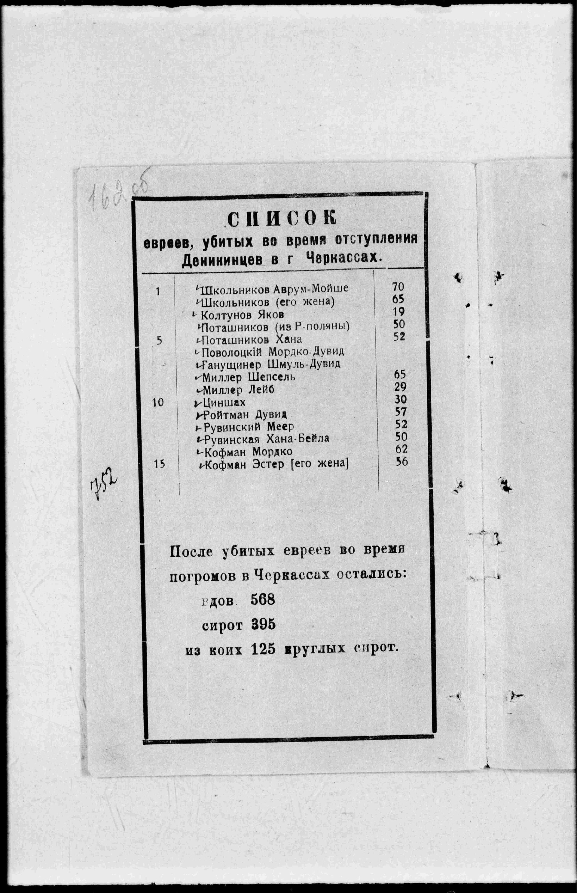

# Ганущинер Шмуль-Дувид, Черкассы, убит при отступлении деникинцев

Персона из архива. **В дереве Никиты его нет.** Связь с деревом пока **гипотеза**, в MyHeritage и в граф ничего не записано.

## Запись в архиве

| Поле | Значение |
| --- | --- |
| Как записано | Ганущинер Шмуль-Дувид |
| Латиницей на сайте | Szmul-Duwid Ganuszcziner (GANUSZCZINER) |
| Роль | жертва |
| Событие | убит во время отступления деникинцев, г. Черкассы |
| Дата на сайте | 1920 (год документа) |
| Возраст | **не указан** (у соседей по списку возраст есть, у него и у Поволоцкого графа пустая) |
| Архивный шифр | ДАКО (Державний архів Київської області), ф. Р-3050, оп. 1, спр. 54, арк. 162 зв. (на сайте: DAKO P-3050-1-54) |
| Фонд | Киевская районная комиссия Еврейского общественного комитета помощи пострадавшим от погромов (Евобщестком), 1920–1924 |
| Дело | 1920–1922. Доклад уполномоченных и сведения о погромах еврейского населения в Смелянском районе и г. Черкассы |
| Документ | «СПИСОК евреев, убитых во время отступления Деникинцев в г. Черкассах», запись 7 из 15 |
| Страница скана | 284 |
| ID записи archival.name | `PGR-P0493-284-R7`, этот человек `PGR-P0493-284-R7-7` |
| Где искать | [archival.name: поиск ganuschiner](https://archival.name/ru/ukraine/pogrom-relief-resettlement-1917-1938/?q=ganuschiner), группа дел «Комитеты помощи пострадавшим от погромов 1917–1924». На сайте есть ссылки на скан и на всё дело в Wikimedia Commons. |

Копия скана: [DAKO_R-3050-1-54_p284.jpg](../assets/DAKO_R-3050-1-54_p284.jpg)

### Весь список с этого листа

1. Школьников Аврум-Мойше, 70
2. Школьников (его жена), 65
3. Колтунов Яков, 19
4. Поташников (из Р-поляны), 50
5. Поташникова Хана, 52
6. Поволоцкий Мордко-Дувид, возраст не указан
7. **Ганущинер Шмуль-Дувид, возраст не указан**
8. Миллер Шепсель, 65
9. Миллер Лейб, 29
10. Циншах, 30
11. Ройтман Дувид, 57
12. Рубинский Меер, 52
13. Рубинская Хана-Бейла, 50
14. Кофман Мордко, 62
15. Кофман Эстер (его жена), 56

Под списком: после погромов в Черкассах остались 568 вдов и 395 сирот, из них 125 круглых.

## Что нашлось в дереве

Проверено 2026-11-17: `wiki/people/` (193 страницы из GEDCOM), `data/family_graph.json` (10 349 человек дерева и 38 014 человек, собранных из совпадений), `data/graph_updates.jsonl` (12 155 записей). Ни Шмуля, ни Шмиля, ни Самуила, ни Шмуэля с фамилией Ганущинер нигде нет.

Фамилия очень редкая. Все Ганущинеры в дереве идут от одной несвижской семьи (Файвел, 1760). В Черкассах на 1919 год из неё жили:

- [[Мордха Евсеевич Ганущинер (1860)]] с женой [[Хая]], прямой предок Никиты в 5-м колене. Его дети родились в Черкассах между 1896 и 1912 годами.
- Их дети: [[Лейб (Лев) Мордухович Ганущинер (1896)]] (прапрадед), [[Голда Мордуховна Ганущинер (1901)]], [[Мириль Мордуховна Ганущинер (1904)]], [[Зылык Ганущинер (1906)]], [[Элка Ганущинер (1910)]], [[Бруха (Броня) Мордуховна Ганущинер (1912)]] и **[[Дудл Мордухович Ганущинер]], у которого нет ни одной даты.**
- Сестра Мордхи [[Сура Евсеевна Ганущинер]] (замужем за Рейнгольцем), жила и умерла в Черкассах; её сын [[Дувед Рейнгольц]].

Линия Никиты: Никита → мама Марина Колонова → [[Раиса Васильевна Кузьмина (1940)]] → [[Хая (Клара) Лейбовна (Львовна) Ганущинер (1923)]] (род. Черкассы) → Лейб (род. Черкассы 1896) → Мордха.

## Гипотеза

**Шмуль-Дувид, скорее всего, родственник черкасской семьи Мордхи. Возможно, это и есть Дудл Мордухович.**

Что за:

1. **Фамилия и место.** Ганущинер встречается редко, а все известные Ганущинеры в Черкассах этого времени принадлежат одной семье.
2. **Имя.** «Дудл» это бытовая уменьшительная форма от Довид / Дувид. Двойное имя Шмуль-Дувид в документе и одно домашнее «Дудл» в семейном дереве вполне могут быть одним человеком.
3. **Обычай имянаречения.** У ашкеназов ребёнка называют в честь уже умершего родственника, но не в честь живого. [[Давид (Женя) Лейбович Ганущинер (1921)]], сын Лейба, родился в Черкассах 23 мая 1921 года, примерно через полтора года после гибели Шмуль-Дувида. Это хорошо ложится на «назвали в память о дяде Дувиде». Доказательством это не является.
4. **Дудла нет ни в одной дате.** Если он погиб молодым в 1919 году, это объясняет, почему у потомков о нём ничего не осталось, кроме имени.

Что против или не проверено:

- В списке нет возраста, поэтому нельзя сказать, кем он был: сыном Мордхи, его братом или более дальним родственником.
- Имя Шмуль в семье нигде не встречается.
- Дерево Анны Зольдиной (потомки Брухи) знает Дудла тоже без дат.

## Насколько уверен

| Утверждение | Уверенность |
| --- | --- |
| Это человек из черкасской семьи Ганущинеров, родственник Никиты | **средняя** (около 60–70 %) |
| Это именно Дудл Мордухович, брат прапрадеда Лейба | **низкая** (около 30–40 %) |
| Прямой предок Никиты | **нет**: все прямые предки этого поколения известны и живы после 1920 года. VIP-уведомление не нужно. |

Если он Дудл, то для Никиты это **брат прапрадеда Лейба**, то есть двоюродный прапрадед, сын прапрапрадеда Мордхи.

## Осторожно: путаница Лейб ↔ Дудл в MyHeritage

При проверке всплыла отдельная проблема.

- В GEDCOM (2026-06-23) профиль `@I66@` это Лейб, `@I103@` это Дудл.
- 2026-09-07 21:35 агент обработал Smart Match, где профилю Лейба (MyHeritage ID 5000066) предложен «Дудл Ганущинер» из дерева Зольдиной. В сравнении левая сторона уже показывала «Дудл Мордухович Ганущинер, 1896–1973, Прапрадедушка».
- 2026-09-08 в сессионных логах профиль 5000066 называется «Дудл Мордухович», а профиль 5000103 называется «Лейб (Лев) Мордухович».

Похоже, в дереве на MyHeritage имена Лейба и Дудла поменялись местами, а годы 1896–1973 и дети Лейба стоят теперь под именем Дудла. **Это нужно проверить руками на MyHeritage**, прежде чем что-то записывать про Дудла. Агент сам ничего не правит (§3.4 [правил](../../docs/RULES.md)).

## Что делать дальше

1. Никите открыть на MyHeritage профили Лейба и Дудла и вернуть правильные имена, если путаница подтвердится.
2. Спросить родственников по линии Зольдиных и Школьниковых, кем был Дудл и когда он умер.
3. Посмотреть соседние листы того же дела (ДАКО Р-3050-1-54) на Wikimedia Commons: там бывают анкеты вдов и сирот с именами членов семьи.
4. Только после подтверждения добавлять в дерево дату и обстоятельства смерти.

## Попутная зацепка

Первые в том же списке: **Школьников Аврум-Мойше (70) и его жена (65)**. [[Мириль Мордуховна Ганущинер (1904)]] была замужем за [[Герш-Лейб Хаимович Школьников]]. Его отец Хаим, так что Аврум-Мойше ему не отец, но мог быть родственником той же черкасской семьи. Не проверено.

## Источник

О самом сайте и о том, можно ли подключить его постоянно: [archival-name](archival-name.md).
